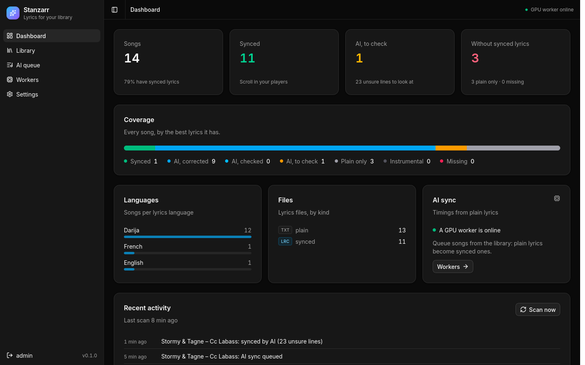
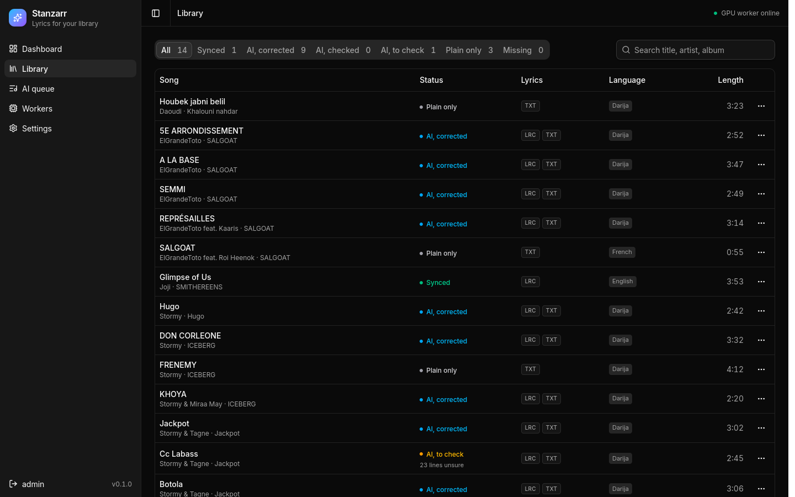
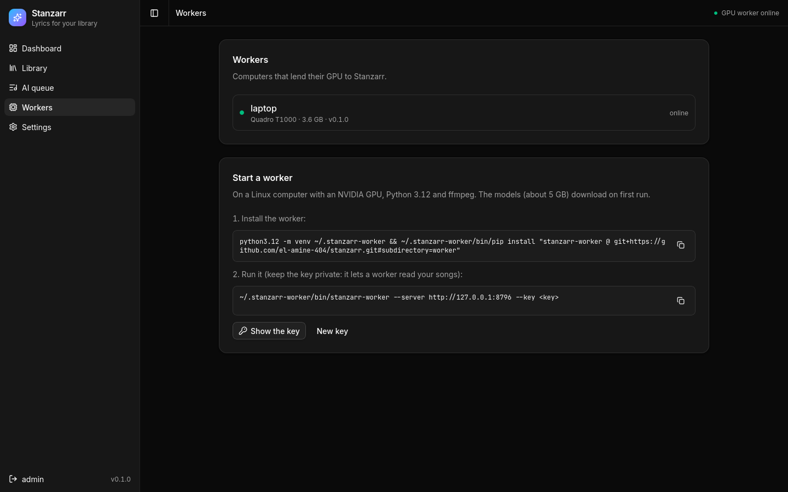

<div align="center">

# Stanzarr

**Lyrics for your music library, the \*arr way.**

Stanzarr keeps track of every song's lyrics, fetches what is missing from
LRCLIB, turns plain lyrics into synced ones with AI on your GPU, and gives you
an editor to fix the timings by ear and by eye.

</div>



## Why

Sonarr, Radarr and Lidarr fetch the media; Bazarr fetches subtitles. Lyrics had
nothing like it: songs end up with plain text that never scrolls, or with
nothing at all, and nobody knows which. Stanzarr is that missing piece. It
writes standard `.lrc` files beside your songs, so Navidrome, Jellyfin,
Feishin, Symfonium and most players pick them up with no plugin.

## Features

- **Library tracking.** Every song and every lyrics file: `.lrc`, enhanced
  `.elrc`, `.txt`, `.ttml`, Navidrome's `.yaml`, and lyrics embedded in the
  audio tags. Status per song (synced, AI to check, plain only, missing),
  language detection (including Darija written in Latin letters), and where
  each file came from.
- **LRCLIB.** New songs are looked up at once, and songs without lyrics synced
  by a person again every 30 days. LRCLIB often holds a song several times
  under different credits; Stanzarr weighs every entry and prefers synced ones.
- **AI sync, on your GPU.** Plain lyrics become synced lyrics: the voice is
  separated (Demucs), three aligners place every line (Whisper large-v3-turbo,
  Whisper large-v3, Meta's MMS) and the median wins. Lines where they disagree
  are marked for you to check. Measured against songs a person had synced:
  86% of lines within one second, 94% where the aligners agree.
- **A worker, not a requirement.** Stanzarr itself needs no GPU. A worker on
  any computer with an NVIDIA card lends its GPU; without one, AI sync is
  simply disabled.
- **An editor made for timing.** Waveforms of the song and of the voice alone,
  snap to where the voice comes in, millisecond nudges, karaoke preview, drag
  words between lines, duplicate a chorus, undo everything.
- **Safe by default.** A file synced by a person is never overwritten. AI files
  say so in the file itself, and are replaced when a person-synced version
  appears; the replaced file is kept in a backup first. Read-only mode for
  trying it out.

<table>
<tr><td></td><td></td></tr>
</table>

## Quick start

```yaml
services:
  stanzarr:
    image: ghcr.io/el-amine-404/stanzarr:0.1.0
    user: "1000:1000"            # the owner of your music files
    environment:
      - STANZARR_LIBRARY=/music
    volumes:
      - ./config:/config
      - /path/to/music:/music
    ports:
      - "6868:6868"
    restart: unless-stopped
```

Open `http://localhost:6868` and create your account. The first scan starts at
once. See [docker-compose.example.yml](docker-compose.example.yml) for a
hardened setup.

### AI sync worker

On a Linux computer with an NVIDIA GPU (4 GB is enough), Python 3.12 and ffmpeg:

```sh
python3.12 -m venv ~/.stanzarr-worker
~/.stanzarr-worker/bin/pip install "stanzarr-worker @ git+https://github.com/el-amine-404/stanzarr.git#subdirectory=worker"
~/.stanzarr-worker/bin/stanzarr-worker --server http://your-stanzarr:6868 --key <key from Workers>
```

The models (about 5 GB) download on the first job. See [docs/worker.md](docs/worker.md).

## Configuration

| Variable | Default | |
|---|---|---|
| `STANZARR_LIBRARY` | `/music` | Music folders, separated by `:` |
| `STANZARR_CONFIG_DIR` | `/config` | Database, cache, backups, AI results |
| `STANZARR_PORT` | `6868` | |
| `STANZARR_USERNAME` / `STANZARR_PASSWORD` | | Create the account at start instead of on the first visit |
| `STANZARR_READ_ONLY` | `0` | Never write into the library |
| `STANZARR_LRCLIB` | `1` | Look up lyrics on LRCLIB |
| `STANZARR_RETRY_DAYS` | `30` | Ask LRCLIB again after this many days |
| `STANZARR_SCAN_INTERVAL` | `600` | Seconds between library scans |
| `STANZARR_WORKER_KEY` | generated | The key workers authenticate with |
| `STANZARR_TRUSTED_PROXIES` | `127.0.0.1` | Proxies whose `X-Forwarded-For` is believed |
| `STANZARR_COOKIE_SECURE` | `0` | Session cookie over HTTPS only |

## How lyrics files are marked

Stanzarr leaves its marks in standard LRC info tags, which players ignore:

```
[by:AI-generated, not checked by a person]
[re:Stanzarr AI sync 2026-10-12: Demucs htdemucs + Whisper large-v3-turbo + Whisper large-v3 + MMS, median vote]
[#:uncertain lines (the methods disagree): 3, 12, 19]
```

See [docs/lyrics-files.md](docs/lyrics-files.md) for every mark and rule.

## Development

```sh
# backend
python3.12 -m venv .venv && .venv/bin/pip install -e "./backend[test]"
.venv/bin/python -m pytest backend/tests
STANZARR_LIBRARY=~/Music STANZARR_CONFIG_DIR=/tmp/stanzarr .venv/bin/python -m stanzarr

# interface (proxies /api to the backend on :6868)
cd frontend && npm ci && npm run dev
```

## License

[GPL-3.0](LICENSE), like the rest of the \*arr family.
