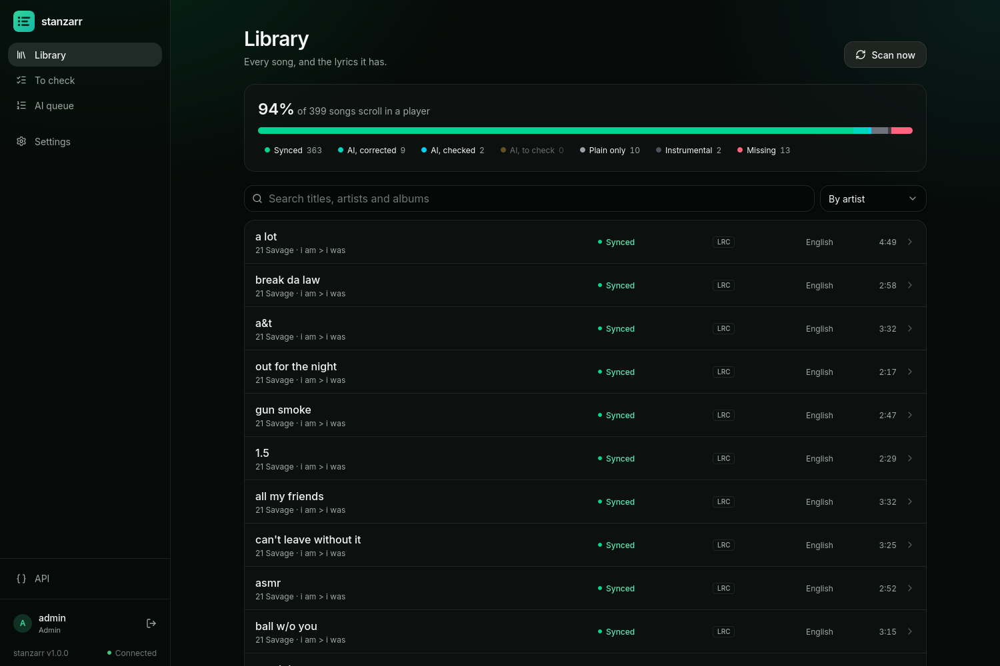

# stanzarr

Lyrics for the music libraries, the \*arr way: every song's lyrics tracked,
what is missing asked of the sources (add-ons, LRCLIB first), plain lyrics
turned into synced ones by AI on a GPU worker, and an editor to fix the
timings by ear. It writes standard `.lrc` files beside the songs, so
Navidrome, Jellyfin, Feishin and most players scroll them with no plugin.
Other apps ask it for any song's lyrics: `GET /api/v1/lyrics`; a person, on
its home page, by the song's name or a link to it.

Part of batlab: built like its other apps (`lib/batlab-common`,
`lib/batlab-ui`), and described with them in
[docs/services.md](../../../docs/services.md). Its reference is at `/docs` on
the running service.



| | |
| --- | --- |
| `backend/` | The server (FastAPI, SQLite): the scanner, the lyrics files, the sources, the queue, the API. |
| `frontend/` | The page (React, batlab-ui). |
| `worker/` | `stanzarr-worker`: lends a GPU to AI sync ([docs/worker.md](docs/worker.md)). |
| `docs/` | How lyrics files are read and written ([lyrics-files.md](docs/lyrics-files.md)), the worker. |

## The rules it keeps

- A synced `.lrc` made by a person is never overwritten automatically.
- An AI-synced file says so in itself, and is replaced when a person-synced
  version appears; the replaced file is kept in a backup first.
- Plain lyrics (`.txt`) are never deleted; synced ones are written beside them.
- Nothing from a source is written before it passes the filter
  (`lyricsfiles.sanitize`); what it refuses goes to `quarantine/`.
- A song is searched until it reaches the quality cutoff (Settings, General),
  and a better version is always taken.
- `STANZARR_READ_ONLY=1` writes nothing at all.

## Sources are add-ons

A source is one module in `backend/stanzarr/sources/`: a `LyricsSource` with
its form's fields and a `search()`, listed in `TYPES`. Settings, Sources
makes them, orders them, turns them on and off and tests them; nothing else
in stanzarr knows which there are. LRCLIB, NetEase, Musixmatch, Genius and lyrics.ovh
come with it; `sources/http.py` keeps each site to one question a second.

## The GPU worker

On a Linux computer with an NVIDIA GPU (4 GB is enough), Python 3.12 and ffmpeg:

```sh
python3.12 -m venv ~/.stanzarr-worker
~/.stanzarr-worker/bin/pip install "stanzarr-worker @ git+https://github.com/el-amine-404/batlab.git#subdirectory=compose/stanzarr/app/worker"
~/.stanzarr-worker/bin/stanzarr-worker --server http://stanzarr.homelab.lan --key <its own key: Settings, Workers, Add a worker>
```

## Working on it

```sh
# the backend's tests, in the image as built (make up runs them)
docker build --target tested compose/stanzarr/app …
# the page against a running stanzarr
cd frontend && npm install && STANZARR_API=http://stanzarr.homelab.lan npm run dev
# after a change to the API: the page's types
STANZARR_OPENAPI=http://stanzarr.homelab.lan/api/v1/openapi.json npm run gen:api
```

GPL-3.0-or-later (LICENSE).
