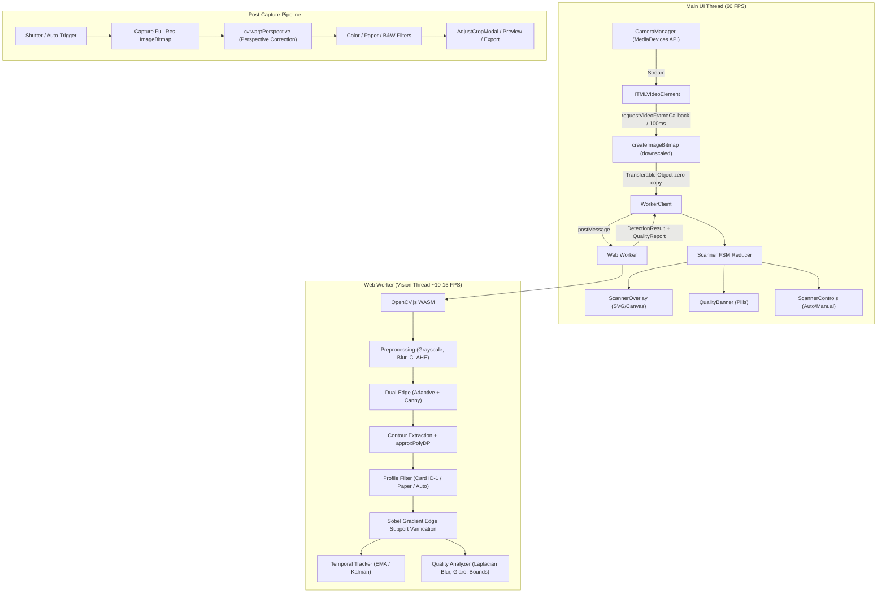
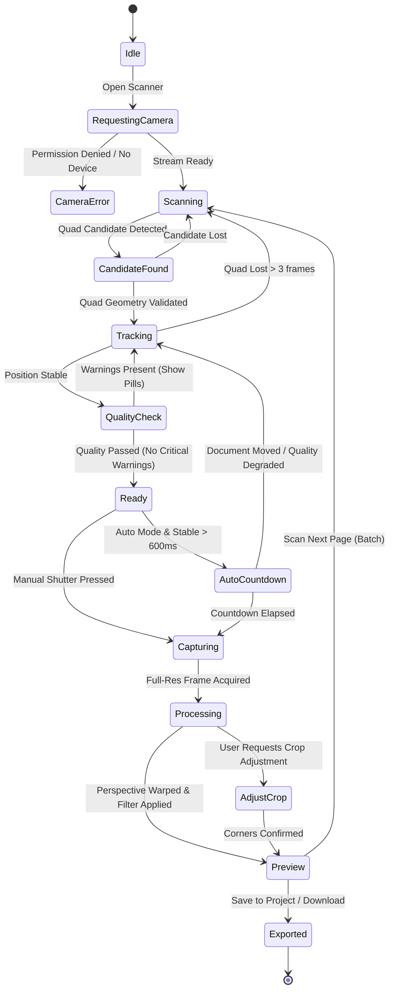

# Technical Architecture Assessment: Production-Ready Smart Scanner

This specification defines the production-grade browser-native document and card scanning subsystem integrated into the existing Scanloom application architecture.

---

## 1. Existing Architecture Overview

### Repository Context & Deployment
- **Repository Root**: `/home/bro/batlab` (Homelab deployment managed via `Makefile` and Docker Compose).
- **Application Target**: `Scanloom` in `compose/scanloom/`, a privacy-first web document processing service hosted on `lab2` (`192.168.1.201`) and reverse-proxied via Caddy at `https://scanloom.homelab.lan`.

### Frontend Stack
- **Framework**: React 19 (`react` `19.3.0`, `react-dom` `19.3.0`).
- **Routing**: React Router 7 (`react-router` `7.18.3`).
- **State Management**:
  - Server state: TanStack Query v5 (`@tanstack/react-query` `5.104.1`) with real-time Server-Sent Events (`EventSource`).
  - Client state: Idiomatic React hooks (`useState`, `useRef`, `useReducer`).
  - Persistent state: `localStorage` for theme (`scanloom.theme`) and scan history (`scanloom.recent.v1`).
- **Build System**: Vite 8 (`vite` `8.3.4`, `@vitejs/plugin-react` `6.1.2`), targeting `es2022`.
- **Styling & Design System**: Tailwind CSS v4 (`@tailwindcss/vite` `4.3.3`, `tailwindcss` `4.3.3`), `clsx` `2.1.1`, `tailwind-merge` `3.7.0`, `class-variance-authority` `0.7.1`. Design tokens are defined via CSS custom properties in `style.css` (`--ink`, `--muted`, `--line`, `--card`, `--deep`, `--mint`, `--mint-dark`, `--sand`, `--danger`, `--warn`) with light and dark mode (`html[data-theme="dark"]`).
- **UI Components**: Radix UI primitives (`radix-ui` `1.8.1`), Lucide React icons (`lucide-react` `1.56.0`), Sonner toast notifications (`sonner` `2.0.8`).
- **PWA Infrastructure**: Web app manifest (`manifest.webmanifest`), service worker (`sw.js`), and camera access configured via `Permissions-Policy: camera=(self)` in `Caddyfile`.

### Backend Stack
- Python 3.13 (`python:3.13-slim-trixie`), FastAPI `0.162.0`, Uvicorn `0.54.0`, libvips `8.16` (`pyvips` `3.2.0`), ONNX Runtime `1.31.1` with DocAligner (`docaligner.onnx`), PostgreSQL 17 Alpine, and ClamAV `1.4` malware scanning.

---

## 2. Existing Modules That Can Be Reused

1. **Design System & UI Primitives** (`compose/scanloom/app/frontend/src/ui.tsx`):
   - `Button`: Primary, secondary, ghost, danger buttons.
   - `Dialog`: Accessible modal container with backdrop blur, focus trap, and keyboard accessibility.
   - `Select`: Accessible dropdown wrapping Radix UI `SelectPrimitive` (ideal for camera device switching, scan profile selection, and resolution choice).
   - `Badge`: Status badges (`good`, `warn`, `bad`, `neutral`).
2. **Crop & Corner Loupe System** (`compose/scanloom/app/frontend/src/App.tsx`):
   - `CropEditor` already provides an interactive SVG coordinate manipulation tool with draggable corner handles (`.crop-handle`), pointer event capture, boundary lines, and a touch-friendly circular magnifying loupe (`.crop-loupe`). This exact interaction pattern is reused for post-capture manual corner refinement.
3. **Design Tokens & Theme Tokens** (`compose/scanloom/app/frontend/src/style.css`):
   - Colors, typography (`Inter Variable`), dark/light theme variables, camera guide styles (`.camera-guide-svg`, `.camera-guide-poly`, `.camera-guide-corner`, `.camera-status-pill`).
4. **Types & Shared Utilities** (`compose/scanloom/app/frontend/src/lib.ts`):
   - `Point = [number, number]` normalized coordinates `[0..1]`.
   - `cx(...)`: Class name merger.
   - `toast` from `sonner`: Standardized user feedback mechanism.

---

## 3. Recommended Scanner Integration Location

The smart scanner upgrades and replaces the existing camera modal `CameraCapture.tsx` in `compose/scanloom/app/frontend/src/`.

### Key Integration Points:
- **Primary Trigger**: The "Open camera" action on the Home view (`App.tsx`) launches `<SmartScanner />`.
- **Batch Scanning Support**: Instead of closing immediately after a single photo, the smart scanner supports continuous page capture ("Scan Next Page" / Auto-capture batching), allowing multi-page document or double-sided card scanning in one fluid session.
- **Output Handlers**:
  - `onCapture(file: File)`: Continues feeding captured, locally perspective-corrected pages into the Scanloom project workflow without breaking any existing backend contract.
  - Client-side export: Directly download locally corrected JPEG, PNG, or client-rendered PDF without contacting the backend when working in offline/private mode.

---

## 4. Proposed Folder Structure

```
compose/scanloom/app/frontend/
├── public/
│   └── vendor/
│       └── opencv/
│           ├── opencv.js              # Pinned OpenCV.js WebAssembly loader
│           └── opencv.wasm            # Compiled OpenCV WebAssembly binary
├── src/
│   ├── scanner/
│   │   ├── types.ts                   # Discriminated union states, Quad, QualityReport, ScannerConfig
│   │   ├── state.ts                   # Strict finite state machine (FSM) & action reducer
│   │   ├── camera/
│   │   │   ├── manager.ts             # MediaDevices API, device enumeration, switching, resolution, torch
│   │   │   └── useCamera.ts           # React lifecycle hook for camera feed
│   │   ├── vision/
│   │   │   ├── worker.ts              # Dedicated Web Worker running OpenCV.js off the UI thread
│   │   │   ├── worker-client.ts       # Main-thread client sending transferable ImageBitmaps
│   │   │   ├── cv-loader.ts           # OpenCV.js WASM lazy loader and memory-safe Mat wrappers
│   │   │   ├── profiles.ts            # Card (ID-1), Paper (A4/Receipt), Auto detection profiles
│   │   │   ├── detector.ts            # OpenCV preprocessing, Canny/Adaptive edges, approxPolyDP
│   │   │   ├── tracker.ts             # Temporal corner tracking & EMA/Kalman jitter smoothing
│   │   │   └── quality.ts             # Quality analyzer: Laplacian blur, glare detection, exposure, bounds
│   │   ├── processing/
│   │   │   ├── perspective.ts         # Browser-side 4-point perspective warp (warpPerspective)
│   │   │   ├── filters.ts             # Enhancement presets: faithful color, clean paper, black & white
│   │   │   └── export.ts              # Client-side JPEG/PNG Canvas export & client PDF generator
│   │   ├── ui/
│   │   │   ├── ScannerModal.tsx       # Root dialog container (replaces CameraCapture.tsx)
│   │   │   ├── ScannerOverlay.tsx     # 60 FPS SVG/Canvas guide overlay (corners, boundary polygon, guides)
│   │   │   ├── QualityBanner.tsx      # Real-time feedback pills ("Move closer", "Hold steady", "Glare detected")
│   │   │   ├── ScannerControls.tsx    # Shutter button, Auto/Manual toggle, torch, camera switch, profile selector
│   │   │   └── AdjustCropModal.tsx    # Manual corner refinement modal (reusing loupe tool from CropEditor)
│   │   └── index.ts                   # Public entry point exporting <SmartScanner />
│   └── __tests__/
│       ├── scanner-geometry.test.mjs  # Unit tests for aspect ratios, angle tolerances, convexity
│       ├── scanner-tracker.test.mjs   # Unit tests for jitter filter and temporal stability
│       ├── scanner-quality.test.mjs   # Unit tests for blur, glare, and exposure analysis
│       └── test-dataset/              # Ground-truth test images across the 10 required scenarios
```

---

## 5. Dependency Additions and Technical Justification

1. **OpenCV.js (WebAssembly)**:
   - *Technical Justification*: Direct requirement in specification ("Use OpenCV.js for the initial computer vision implementation"). Provides standardized implementations of:
     - Edge detection (`cv.Canny`)
     - Adaptive thresholding (`cv.adaptiveThreshold`)
     - Contour hierarchy & polygon approximation (`cv.findContours`, `cv.approxPolyDP`)
     - Matrix perspective transformations (`cv.getPerspectiveTransform`, `cv.warpPerspective`)
     - Blur estimation via Laplacian kernel variance (`cv.Laplacian`)
   - *Architecture Fit*: Deployed as static WASM assets in `public/vendor/opencv/` and loaded strictly inside a Web Worker. This avoids bundle bloat and guarantees zero UI thread blocking.
2. **Client-Side PDF Generation (Minimal Zero-Dependency / Light Writer)**:
   - *Technical Justification*: Client-side JPEG and PNG exports are natively supported by HTML5 Canvas (`canvas.toBlob(...)`). For client-side PDF export without backend transmission, a lightweight PDF builder (`pdf-lib` or a minimal direct PDF stream builder) is used.
3. **No Redundant State Libraries**:
   - Zero additions for state management: React 19's `useReducer` with a strict discriminated union pattern fulfills the finite state machine requirement without adding Redux/Zustand.

---

## 6. Camera and Computer Vision Architecture



### Camera Subsystem:
- **Lifecycle & Device Selection**: Enumerate devices via `navigator.mediaDevices.enumerateDevices()`, prioritize `facingMode: { ideal: "environment" }` on mobile devices with fallback to desktop webcams.
- **Torch / Flashlight**: Feature-detect `track.getCapabilities().torch` and toggle via `track.applyConstraints({ advanced: [{ torch }] })`.
- **Resource Discipline**: Automatically detach and stop all media tracks on dialog unmount or app backgrounding (`visibilitychange`).

### Dual-Resolution Vision Subsystem:
- The video stream operates at full resolution ($1080\text{p} / 4\text{K}$).
- A downscaled processing frame ($320\times 240$ or $400\times 300$) is transferred to the Web Worker via zero-copy `ImageBitmap` transfers.
- **Card Profile**: ID-1 aspect ratio ($1.586 \pm 0.15$), strict corner angle orthogonality ($80^\circ - 100^\circ$), small object area ($1.5\% - 25\%$).
- **Paper Profile**: A4 ($1.414 \pm 0.20$), US Letter ($1.29$), receipts ($1.5 - 3.5$), variable document sizes.
- **Auto Profile**: Evaluates candidates simultaneously, picking the highest-scoring candidate based on edge support and aspect ratio.

### Temporal Corner Tracker:
- Corners are tracked across consecutive frames with an adaptive Exponential Moving Average (EMA):
  - When steady: high damping ($\alpha = 0.35$) for jitter-free edges.
  - When moving: responsive tracking ($\alpha = 0.85$) to eliminate lag.
  - On sudden jump ($> 15\%$ screen shift): reset tracker immediately to prevent elastic rubber-banding.
  - Tolerates up to 3 dropped frames before clearing the overlay.

---

## 7. State Management and Data Flow

To avoid invalid combinations of boolean flags, the scanner state is governed by a strict **Finite State Machine (FSM)**:

```ts
export type ScannerState =
  | { status: "Idle" }
  | { status: "RequestingCamera" }
  | { status: "CameraError"; error: string; code: "DENIED" | "UNAVAILABLE" | "INSECURE" }
  | { status: "Scanning"; mode: "auto" | "manual"; profile: "card" | "paper" | "auto" }
  | { status: "CandidateFound"; quad: Quad; confidence: number }
  | { status: "Tracking"; quad: Quad; stability: number }
  | { status: "QualityCheck"; quad: Quad; warnings: QualityWarning[] }
  | { status: "Ready"; quad: Quad; stabilityDurationMs: number }
  | { status: "AutoCountdown"; quad: Quad; countdownMs: number; progress: number }
  | { status: "Capturing"; quad: Quad }
  | { status: "Processing"; quad: Quad }
  | { status: "AdjustCrop"; rawImage: ImageBitmap; quad: Quad }
  | { status: "Preview"; processedBlob: Blob; quad: Quad }
  | { status: "Exported" };
```



---

## 8. Performance and Browser Compatibility Risks

| Risk Area | Browser / Device Affected | Root Cause | Architectural Mitigation |
|---|---|---|---|
| **WASM Startup Latency** | Mobile Safari / Low-end Android | Downloading and compiling 8MB+ OpenCV.js causes startup delay. | Lazy-load OpenCV.js only upon opening scanner; compile inside Web Worker; cache binary via service worker; show instant skeleton loader. |
| **Main-Thread Jank** | All browsers | Running Canny, contours, and Laplacian on the UI thread drops UI below 60 FPS. | Offload 100% of image processing to a dedicated Web Worker using zero-copy `transferControlToOffscreen` or transferable `ImageBitmap`. |
| **WASM Heap Memory Leaks** | WebKit / Blink | OpenCV C++ `cv.Mat` objects are allocated in WASM linear memory and are not garbage collected by JS. | Strict RAII-style wrappers (`usingMat([m1, m2], () => { ... })`) ensuring every allocated `Mat` is freed immediately within `finally` blocks. |
| **iOS Safari Limitations** | iOS Safari (WebKit) | No torch API support; strict user-activation requirement for camera; canvas memory caps. | Feature-detect torch before rendering UI; enforce user gesture activation; downscale vision canvas to $320\times 240$ to minimize memory footprint. |
| **Android Thermal Throttling** | Budget Android devices | Continuous 30 FPS computer vision overheats mobile chips. | Decouple video preview (60 FPS) from vision inference (capped at 10–12 FPS), throttling frame transfer dynamically if worker latency rises. |
| **Coordinate Transform Distortion** | Mobile devices (Portrait / Landscape) | Aspect ratio mismatch between video sensor (e.g. 16:9), display canvas (`object-fit: cover`), and processing canvas. | Implement explicit affine matrix mapping between camera sensor space, processing canvas space, and viewport CSS pixels. |

---

## 9. Testing and Validation Strategy

A dedicated computer vision validation suite is integrated into `src/__tests__/`:

### Ground-Truth Test Dataset (`src/__tests__/test-dataset/`):
Test images spanning the 10 required scenarios:
1. **Cards on light backgrounds** (white table, light counters).
2. **Cards on dark backgrounds** (black desk, dark leather).
3. **White paper on white surfaces** (low contrast boundaries).
4. **Harsh directional shadows** (desk lamp, overhead lights).
5. **Low-light environments** (dim room, sensor noise).
6. **Glossy reflective cards** (specular reflection / glare).
7. **Partially occluded documents** (thumb/fingers holding the border).
8. **High perspective angles** ($30^\circ - 45^\circ$ oblique angles).
9. **Cluttered scenes** (multiple rectangular objects, screens, notebooks).
10. **Motion blur & camera shake** (unsteady hands).

### Automated Test Metrics:
- **Detection Rate**: True Positive % on test dataset (Target: $> 95\%$ on standard, $> 85\%$ on difficult).
- **False Positive Rate**: Target: $0\%$ on people, blank walls, or arbitrary silhouettes.
- **Corner Localization Error**: Mean Euclidean pixel distance between detected corners and annotated ground truth.
- **Detection Latency**: Processing time per frame (Target: $< 50$ms on desktop, $< 90$ms on mobile).
- **Memory Stability**: Continuous 10-minute automated frame processing test ensuring zero memory growth in WASM heap.

---

## 10. Phased Implementation Plan

- **Phase 0: Repository Analysis & Architecture Assessment** (*Current step - baseline agreed*).
- **Phase 1: Foundation & Web Worker Vision Harness**:
  - Deploy pinned OpenCV.js WebAssembly static assets into `public/vendor/opencv/`.
  - Implement Web Worker client harness with transferable `ImageBitmap` messaging.
  - Implement memory-safe `cv.Mat` wrappers.
- **Phase 2: Camera Management & Device Selection**:
  - Implement `CameraManager` and `useCamera` hook.
  - Support device enumeration, camera switching, resolution constraints, orientation, and torch feature detection.
- **Phase 3: Multi-Profile Document Detection Engine**:
  - Implement grayscale conversion, noise reduction, and adaptive/Canny edge detection.
  - Implement Card profile, Paper profile, and Auto profile with edge support verification.
- **Phase 4: Corner Tracking & Polish Overlay**:
  - Implement temporal tracking (EMA/Kalman filter with outlier rejection).
  - Build responsive SVG overlay with active corners, bounding polygon, and status pills matching Scanloom design tokens.
- **Phase 5: Quality Analysis & Capture Controller**:
  - Implement Laplacian blur, glare reflection, exposure, and boundary margin analyzers.
  - Implement Auto-capture countdown controller and manual capture fallback.
- **Phase 6: Client-Side Perspective Correction, Enhancement & Export**:
  - Implement 4-point perspective warp (`cv.warpPerspective`) on full-resolution capture.
  - Manual corner adjustment modal reusing Scanloom's loupe tool.
  - Enhancement presets: faithful color, clean paper, black & white.
  - Client export to JPEG, PNG, and PDF.
- **Phase 7: Production Hardening & Benchmarking**:
  - Run automated dataset benchmarks across all 10 scenario sets.
  - Verify mobile browser compatibility (iOS Safari, Android Chrome) and desktop browsers.

---

## 11. Files That Would Be Created or Modified

### Files to be created:
- `public/vendor/opencv/opencv.js` & `opencv.wasm`
- `src/scanner/types.ts`
- `src/scanner/state.ts`
- `src/scanner/camera/manager.ts`
- `src/scanner/camera/useCamera.ts`
- `src/scanner/vision/worker.ts`
- `src/scanner/vision/worker-client.ts`
- `src/scanner/vision/cv-loader.ts`
- `src/scanner/vision/profiles.ts`
- `src/scanner/vision/detector.ts`
- `src/scanner/vision/tracker.ts`
- `src/scanner/vision/quality.ts`
- `src/scanner/processing/perspective.ts`
- `src/scanner/processing/filters.ts`
- `src/scanner/processing/export.ts`
- `src/scanner/ui/ScannerModal.tsx`
- `src/scanner/ui/ScannerOverlay.tsx`
- `src/scanner/ui/QualityBanner.tsx`
- `src/scanner/ui/ScannerControls.tsx`
- `src/scanner/ui/AdjustCropModal.tsx`
- `src/scanner/index.ts`
- `src/__tests__/scanner-vision.test.mjs`
- `src/__tests__/scanner-dataset.test.mjs`

### Files to be modified:
- `compose/scanloom/app/frontend/src/CameraCapture.tsx`: Re-exports `<SmartScanner />` with full backward-compatible props.
- `compose/scanloom/app/frontend/src/App.tsx`: Connects multi-page scanning flow to batch file staging on `Home`.
- `compose/scanloom/app/frontend/src/style.css`: Adds scanner overlay styles, countdown animations, and control button styling.
- `compose/scanloom/app/frontend/vite.config.ts`: Configures worker bundling and WebAssembly support.
- `compose/scanloom/app/frontend/Caddyfile`: Verifies CSP allows `'wasm-unsafe-eval'` for WebAssembly instantiation.

---

## 12. Potential Conflicts With Existing Functionality

1. **Dual Processing Alignment (Client vs Server)**:
   - When a document is scanned with the client-side smart scanner, the client sends the already perspective-corrected page along with its detected `corners: [[0,0],[1,0],[1,1],[0,1]]` and metadata `client_deskewed: true`. The backend worker recognizes this flag and performs normalization and malware scanning without attempting redundant boundary detection.
2. **Caddy Content Security Policy**:
   - Update `Caddyfile`'s Content-Security-Policy header to `script-src 'self' 'wasm-unsafe-eval'` to guarantee cross-browser WebAssembly compilation.
3. **Mobile Screen Orientation & Sensor Aspect Ratios**:
   - Use the `ScreenOrientation` API and video element dimensions to dynamically compute the sensor-to-screen matrix transform.
